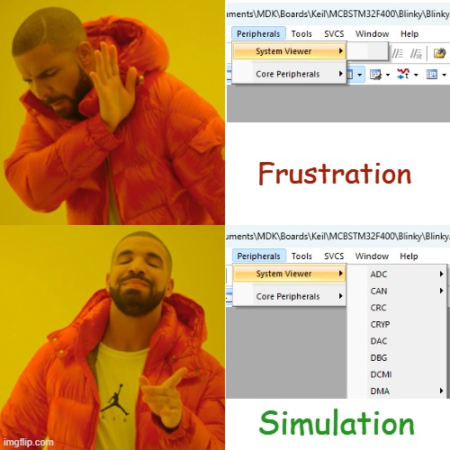

# Keil SVD-to-SFR Converter



## Problem Statement

There is an issue with Pack Installer on some versions of Keil MDK. When the user starts a debug session in uVision, `System Viewer` window cannot be opened, preventing peripheral simulation.

This issue can occur when the required SFR files have not been generated from the installed device packs using `SVDConv.exe`, a utility distributed with Keil MDK.

ARM has acknowledged this issue and provided a workaround in the following article: [uVision Debugger: System Viewer Windows are not available](https://support.arm.com/documentation/ka006065/1-0)

A new version of Pack Installer is available in the link above, but for people who installed so many device packages, it can be tedious to manually reinstall them again. Instead, this utility automates the process by locating existing CMSIS-SVD files and invoking `SVDConv.exe` to generate their corresponding SFR files (needed for simulation), avoiding the need to reinstall device packs individually.

---

## Features

- Recursively discovers CMSIS-SVD files.
- Generates corresponding Keil SFR files using [SVDConv](https://open-cmsis-pack.github.io/svd-spec/main/svd_SVDConv_pg.html).
- Skips files with existing SFR counterparts.
- Supports per-file conversion logging.
- Handles conversion warnings and errors.

---

## Usage

Currently, you need to hardcode these two variables at the top:

```shell
PACKS_DIR="/c/Users/mhamdyx/AppData/Local/Arm/Packs"
SVDCONV="/c/Keil_v5/UV4/SVDConv.exe"
```

Then, on a bash-compatible shell environment (e.g., Git Bash, WSL, MSYS2, or PowerShell), run the script this way:

```shell
./keil_svd_to_sfr.sh  # or bash keil_svd_to_sfr.sh
```

---

## Execution Sample

```shell
================================================
 Generating SFR files from all SVD files
================================================

[+] Processing: STM32F103.svd
    Location: /path/to/STM32F1xx
    [ OK ] SFR generated with no errors (Return Code: 0)

[+] Processing: STM32F407.svd
    Location: /path/to/STM32F4xx
    [WARN] SFR generated with warnings (Return Code: 1)

[+] Processing: UnsupportedDevice.svd
    Location: /path/to/UnsupportedDevice
    [FAIL] Failed to generate UnsupportedDevice.sfr due to errors in UnsupportedDevice.svd

[+] Processing: AnotherDevice.svd
    Location: /path/to/AnotherDevice
    [SKIP] AnotherDevice.sfr already exists

[+] Processing: STM32F429.svd
    Location: /path/to/STM32F4xx
    [ OK ] SFR generated with no errors (Return Code: 0)

========== DONE ==========
```
